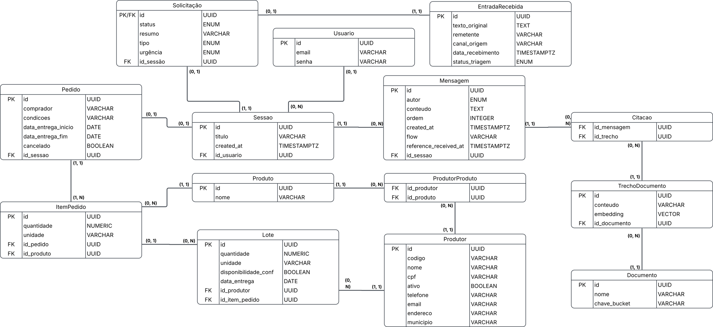

# Banco de dados

O banco de dados principal da aplicação vai ser o PostgreSQL no Cloud SQL da Google Cloud. Ele vai persistir usuários, conversas, pedidos e os trechos usados na consulta documental. Os arquivos originais ficam no Cloud Storage também da Google Cloud e o banco relacional vai guardar a chave dos arquivos para poder acessa-los. O banco vai usar a extensão pgvector para realizar a busca vetorial para o RAG.

## Modelo lógico

Cada solicitação está vinculada a uma sessão de conversa. Uma sessão pode ter até uma solicitação. A opção **Nova conversa** cria uma sessão independente.

Para uma nova demanda recebida por um canal integrado, a aplicação registra a entrada antes da triagem. Ao concluir a análise, o orquestrador cria a solicitação e a sessão na mesma transação. A solicitação fornece os dados do cartão, e a sessão guarda a mensagem original e a análise inicial.

Uma sessão pode ter várias mensagens e até um pedido. O pedido fica disponível no chat da sessão em que foi confirmado. Pedidos cadastrados diretamente podem ficar sem sessão. Cada envio aparece como uma mensagem no histórico do chat.

Cada trecho pertence a um documento. Uma resposta pode citar vários trechos, e um trecho pode aparecer em várias respostas. A aplicação usa o documento de cada trecho para abrir o original no bucket. A exclusão é bloqueada quando alguma resposta cita o documento.

## Dicionário de dados

| Entidade | Campos | Restrições |
| --- | --- | --- |
| `Usuario` | `id` (UUID), `email` (VARCHAR), `senha` (VARCHAR) | `id` é a chave primária. O e-mail é único e `senha` guarda o hash. |
| `Sessao` | `id` (UUID), `titulo` (VARCHAR) | `id` é a chave primária. |
| `Solicitacao` | `id` (`UUID`), `status` (`ENUM`), `resumo` (`VARCHAR`), `tipo` (`ENUM`), `urgencia` (`ENUM`), `id_sessao` (`UUID`) | `id` é a chave primária. `id_sessao` é uma FK obrigatória e única para `Sessao`. `status` começa em `recebida` e segue o RF15. `tipo` e `urgencia` seguem o RF04. |
| `Mensagem` | `id` (UUID), `id_sessao` (UUID), `autor` (ENUM), `conteudo` (VARCHAR), `ordem` (INTEGER) | `id_sessao` é uma FK obrigatória. `ordem` é única dentro da sessão. |
| `Pedido` | `id` (UUID), `id_sessao` (UUID), `comprador` (VARCHAR), `produtos` (VARCHAR), `condicoes` (VARCHAR), `data_entrega_inicio` (DATE), `data_entrega_fim` (DATE), `cancelado` (BOOLEAN) | `id_sessao` é uma FK opcional e única. A data final é preenchida quando a entrega tem um intervalo. |
| `Documento` | `id` (UUID), `nome` (VARCHAR), `chave_bucket` (VARCHAR) | `chave_bucket` identifica o arquivo original no bucket. |
| `TrechoDocumento` | `id` (UUID), `id_documento` (UUID), `conteudo` (VARCHAR), `embedding` (VECTOR) | `id_documento` é uma FK obrigatória. A dimensão do vetor depende do modelo de embeddings. |
| `Citacao` | `id_mensagem` (UUID), `id_trecho` (UUID) | Os dois campos são FKs e formam a chave primária composta. |

Os campos `produtos` e `condicoes` guardam o texto revisado pelo funcionário. Para uma entrega em data única, o pedido usa `data_entrega_inicio`. O cancelamento mantém o pedido disponível para consulta.