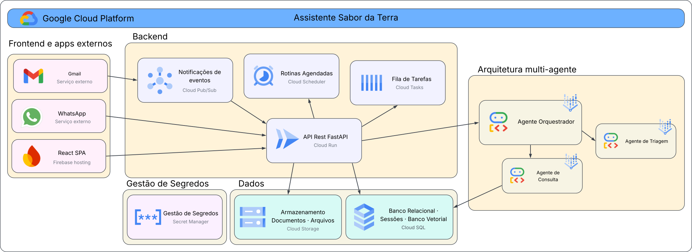

# Infraestrutura

A aplicação usa o Google Cloud. O Firebase Hosting publica a interface React. Um serviço do Cloud Run executa a API FastAPI, o orquestrador e os agentes de triagem e consulta. O Cloud SQL persiste as mensagens recebidas, e o Cloud Tasks limita a carga das triagens para que o mesmo serviço possa atender ao chat.

Os recursos regionais da demonstração ficarão em Iowa (`us-central1`). A região tem tarifas de Tier 1 no Cloud Run e dá acesso à franquia do Cloud Storage. O Cloud Run, o Cloud SQL e o bucket ficarão na mesma região para evitar transferências entre regiões. [Preços do Cloud Run](https://cloud.google.com/run/pricing) · [Franquia do Cloud Storage](https://cloud.google.com/storage/pricing#cloud-storage-always-free-usage-limits)

## Explicação dos serviços

#### Google Cloud Run

O Cloud Run hospeda a API FastAPI e os agentes no mesmo serviço. A API atende ao frontend, recebe as mensagens dos canais integrados e do script Facepe e atende às chamadas autenticadas do Cloud Tasks e do Cloud Scheduler.

A API persiste a entrada no Cloud SQL antes de confirmar o recebimento ao canal e solicita o enfileiramento no Cloud Tasks. Quando a tarefa é disparada, a API recupera o texto e a data de recebimento originais, chama o agente e grava o resultado da triagem.

Escolhemos o Cloud Run porque a carga é pequena e varia ao longo do dia. O serviço ajusta o número de instâncias automaticamente e pode reduzir a zero em períodos sem tráfego. Isso evita manter um servidor ativo só para aguardar mensagens. [Escalonamento do Cloud Run](https://docs.cloud.google.com/run/docs/about-instance-autoscaling)

#### Firebase Hosting

O Firebase Hosting publica os arquivos gerados pelo build do React. Escolhemos o serviço porque o frontend é estático e ele simplifica o deploy porquê já inclui HTTPS e CDN para distribuir esses arquivos e ele usa a API do Cloud Run para as operações da aplicação. [Firebase Hosting](https://firebase.google.com/docs/hosting)

#### Cloud SQL

O Cloud SQL hospeda o PostgreSQL com os usuários, as conversas, os pedidos, as entradas de mensagens e os dados usados na consulta documental. Cada `EntradaRecebida` guarda o UUID, o texto original, o remetente, o canal de origem, a data de recebimento e o estado da triagem. O UUID identifica reentregas. O agente de consulta usa a extensão `pgvector` para buscar trechos que ajudam a responder às perguntas. [Modelo do banco](schemas-db.md) · [Busca vetorial no Cloud SQL](https://docs.cloud.google.com/sql/docs/postgres/ai-overview)

#### Cloud Storage

O Cloud Storage guarda os arquivos originais em um bucket privado. Escolhemos o serviço para armazenar os arquivos como objetos e manter no PostgreSQL a chave, os metadados e os trechos indexados. A API usa a chave para localizar o original quando o funcionário abre uma citação, baixa um documento ou o exclui. [Objetos no Cloud Storage](https://docs.cloud.google.com/storage/docs/objects)

No Cloud Run, configure `DOCUMENT_STORAGE_BACKEND=gcs` e informe o nome do bucket em `DOCUMENT_STORAGE_BUCKET`. O SDK usa as credenciais da conta de serviço vinculada ao Cloud Run. Conceda a essa conta acesso para criar, ler e excluir objetos no bucket privado. [Identidade do Cloud Run](https://docs.cloud.google.com/run/docs/securing/service-identity#call-google-cloud-apis-with-the-service-identity) · [Permissões do Cloud Storage](https://docs.cloud.google.com/storage/docs/access-control/iam-permissions#object_permissions)

Se o log indicar um commit incerto ou uma falha na limpeza, procure a `storage_key` informada no log na tabela `documents` e no armazenamento do mesmo ambiente. Preserve o arquivo se ainda houver um registro para a chave. Se confirmar que o registro está ausente e o arquivo ainda existe, avalie a remoção manual. O nome original pode se repetir entre documentos.

#### Pub/Sub

Na integração do Gmail, o Pub/Sub entrega à API no Cloud Run os avisos de alteração da caixa de entrada. Ao receber um aviso, a API consulta o Gmail para obter as mensagens e registra cada uma pela entrada comum. A caixa integrada e o ID da mensagem no Gmail são usados para definir o UUID da entrada. A entrega do canal define o recorte da consulta à caixa. [Avisos do Gmail](https://developers.google.com/workspace/gmail/api/guides/push) · [Listagem de mensagens](https://developers.google.com/workspace/gmail/api/guides/list-messages)

#### Cloud Tasks

Cada tarefa leva o UUID de uma entrada persistida e chama a rota de processamento no Cloud Run. Configure a fila da demonstração para disparar uma triagem por vez. Como a mesma tarefa pode ser entregue novamente, a API usa o estado da entrada no PostgreSQL para evitar duplicação de resultados. Quando a aplicação registra uma falha de análise antes de criar a solicitação, o funcionário pode pedir outra tentativa pela tela de Triagem, conforme o RF47. [Cloud Tasks com Cloud Run](https://docs.cloud.google.com/run/docs/triggering/using-tasks) · [Limites de execução da fila](https://docs.cloud.google.com/tasks/docs/configuring-queues) · [Requisitos](requisitos.md)

#### Cloud Scheduler

O Cloud Scheduler chama periodicamente a API para recuperar entradas que foram persistidas e ficaram sem enfileiramento. A API no Cloud Run consulta o banco e solicita o enfileiramento dessas entradas no Cloud Tasks.

Quando o Gmail estiver integrado por Pub/Sub, uma chamada diária do Scheduler aciona a renovação da inscrição de avisos da caixa (`watch`). Essas chamadas chegam ao Cloud Run mesmo quando o serviço está com zero instâncias. [Cloud Scheduler com Cloud Run](https://docs.cloud.google.com/run/docs/triggering/using-scheduler) · [Renovação do watch do Gmail](https://developers.google.com/workspace/gmail/api/guides/push#renew_mailbox_watch)

#### Secret Manager

O Secret Manager armazena as credenciais do banco e das integrações com Gmail e WhatsApp. A conta de serviço do Cloud Run recebe acesso aos segredos que a API precisa usar. Escolhemos o serviço para guardar as credenciais fora do código e controlar o acesso e a troca de versões em um único lugar. [Segredos no Cloud Run](https://docs.cloud.google.com/run/docs/configuring/services/secrets)

## Custos previstos

#### Google Cloud Run

Para a demonstração, a estimativa usa os preços de Iowa (`us-central1`) com cobrança por requisição e zero instâncias mínimas. O Google cobra CPU e memória pelo tempo faturável da instância, que inclui processar requisições, iniciar e encerrar. [Modalidades de cobrança](https://docs.cloud.google.com/run/docs/configuring/billing-settings) · [Preços do Cloud Run](https://cloud.google.com/run/pricing)

| Componente | Tarifa em Iowa | Franquia mensal |
| --- | --- | --- |
| CPU | US$ 0,000024 por vCPU-segundo | 180.000 vCPU-segundos |
| Memória | US$ 0,0000025 por GiB-segundo | 360.000 GiB-segundos |
| Requisições | US$ 0,40 por milhão | 2 milhões |

Com até 100 triagens por dia durante 30 dias, estimando 30 segundos faturáveis por triagem, 1 vCPU e 512 MiB, as 3.000 triagens consumiriam cerca de 90.000 vCPU-segundos e 45.000 GiB-segundos. O custo desse processamento é de aproximadamente US$ 2,27 por mês antes da franquia e US$ 0 com a franquia disponível. A franquia é compartilhada pela conta de faturamento. As chamadas do chat e dos webhooks também consomem essa franquia. O tráfego de saída pode ter cobrança própria, assim como os demais serviços e as chamadas ao modelo. [Preços e franquia do Cloud Run](https://cloud.google.com/run/pricing)

#### Firebase Hosting

A franquia por projeto cobre 10 GB de armazenamento e 10 GB de transferência por mês. Com 100 MB de arquivos publicados e até 3 GB de transferência no mês, o custo previsto é **US$ 0**. No plano Blaze, o excedente é cobrado a US$ 0,026 por GB de armazenamento e US$ 0,15 por GB transferido. [Franquia e preços do Firebase Hosting](https://firebase.google.com/docs/hosting/usage-quotas-pricing)

#### Cloud SQL

Para a demonstração, uma instância `db-f1-micro` da edição Enterprise em Iowa, em uma única zona, custa cerca de US$ 7,67 por 730 horas. Com 10 GiB de SSD a US$ 0,17 por GiB por mês, a estimativa fica em **US$ 9,37 por mês**, antes de eventuais cobranças de backup e transferência. O tempo de instância conta enquanto o banco está ligado, mesmo sem consultas. [Preços do Cloud SQL](https://cloud.google.com/sql/pricing)

#### Cloud Storage

Em Iowa, o armazenamento Standard custa US$ 0,020 por GiB por mês. Em um bucket com namespace plano, as gravações e listagens (classe A) custam US$ 0,005 por mil operações e as leituras (classe B), US$ 0,0004 por mil. A franquia mensal cobre 5 GB de armazenamento, 5.000 operações de classe A e 50.000 de classe B. Com 1 GiB armazenado durante o mês, 100 operações de classe A e 3.000 de classe B, o custo previsto é **US$ 0** com a franquia disponível, antes de eventual cobrança por transferência para fora do Google Cloud. [Preços e franquia do Cloud Storage](https://cloud.google.com/storage/pricing)

#### Pub/Sub

A franquia mensal é de 10 GiB por conta de faturamento e o excedente custa US$ 40 por TiB. As publicações e as entregas contam para o consumo. Com 3.000 notificações pequenas do Gmail e uma entrega por notificação, o custo previsto é **US$ 0** com a franquia disponível. [Preços do Pub/Sub](https://cloud.google.com/pubsub/pricing#throughput_costs)

#### Cloud Tasks

A franquia mensal cobre 1 milhão de operações por conta de faturamento e o excedente custa US$ 0,40 por milhão. Para 3.000 triagens no mês, criar e entregar cada tarefa uma vez consome cerca de 6.000 operações. Cada nova tentativa também conta. O custo previsto é **US$ 0** com a franquia disponível. [Preços do Cloud Tasks](https://cloud.google.com/tasks/pricing)

#### Cloud Scheduler

A franquia cobre três jobs por conta de faturamento e cada job adicional custa US$ 0,10 por 31 dias. A cobrança é por job cadastrado, independentemente do número de execuções. Com um job para recuperar entradas sem enfileiramento e outro para renovar a inscrição do Gmail quando o canal estiver integrado por Pub/Sub, o custo previsto é **US$ 0** com a franquia disponível. [Preços do Cloud Scheduler](https://cloud.google.com/scheduler/pricing)

#### Secret Manager

Com até seis versões ativas de segredos e 10.000 acessos no mês, o custo previsto é **US$ 0** com a franquia disponível. Com replicação automática, uma sétima versão ativa durante todo o mês custaria US$ 0,06. Acima da franquia de acessos, a tarifa é de US$ 0,03 por 10.000 operações. [Preços do Secret Manager](https://cloud.google.com/secret-manager/pricing)

## Verificação da demonstração

- Envie uma mensagem pelo Gmail e outra pelo WhatsApp com o funcionário desconectado. Confira se cada mensagem gera um cartão e se a fila executa uma triagem por vez. Em cada canal, envie uma resposta nova a uma mensagem anterior e confira que ela gera outro cartão. Repita a entrega do evento da resposta e verifique que o UUID da entrada e os dois cartões daquela conversa são preservados.
- Execute duas vezes o script das 15 mensagens de `pedidos.json`. Confira que cada entrada mantém o UUID e a data original e que a reentrega não gera cartões duplicados.
- Simule uma falha de enfileiramento depois de persistir uma entrada. Confira que a chamada periódica do Scheduler permite à API reenfileirar a entrada e gerar o cartão. Em outro teste, simule falha na análise e valide **Tentar triagem novamente** na tela, conforme o RF47.
- Valide a API de documentos com um bucket privado. Com um JWT válido, envie dois arquivos com o mesmo nome e conteúdos diferentes. Confira os dois registros na lista e compare os bytes de cada download com os originais. Exclua um dos registros e confira se apenas o objeto correspondente foi removido do bucket e se o outro continua disponível.
- Quando a consulta documental e as citações estiverem disponíveis, adicione um documento, consulte seu conteúdo pelo chat e abra o original pela citação.

O método de publicação e a escolha do framework e do modelo dos agentes ainda serão definidos.
