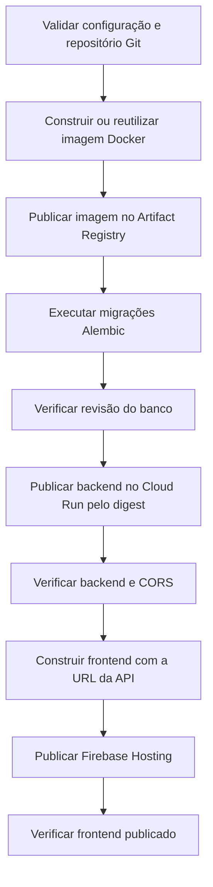

# Infraestrutura

A aplicação utiliza o Google Cloud. O Firebase Hosting publica a interface React, enquanto um serviço do Cloud Run executa a API FastAPI, o orquestrador e os agentes de triagem e consulta implementados com Google ADK.

O Cloud SQL armazena os dados relacionais da aplicação, e o Cloud Storage armazena os arquivos originais dos documentos. O Cloud Tasks e o Cloud Scheduler integram a arquitetura prevista para o processamento assíncrono das mensagens recebidas.

Os recursos são provisionados em um único projeto Google Cloud dedicado à aplicação, ao qual o Firebase também é associado.

Os recursos regionais da demonstração ficam em Iowa (`us-central1`). A região possui tarifas de Tier 1 no Cloud Run e acesso à franquia do Cloud Storage. O Cloud Run, o Cloud SQL, o Artifact Registry e o bucket utilizam a mesma região para reduzir transferências entre regiões.

[Preços do Cloud Run](https://cloud.google.com/run/pricing) · [Franquia do Cloud Storage](https://cloud.google.com/storage/pricing#cloud-storage-always-free-usage-limits)

## Explicação dos serviços

### Google Cloud Run

O Cloud Run hospeda a API FastAPI e os agentes no mesmo serviço.

A API atende às requisições do frontend e disponibiliza as funcionalidades implementadas pelo backend. Com a conclusão das integrações, também receberá mensagens dos canais externos e do script Facepe, além das chamadas autenticadas do Cloud Tasks e do Cloud Scheduler.

No fluxo previsto de processamento assíncrono, a API persiste a entrada no Cloud SQL antes de confirmar seu recebimento ao canal e solicita o enfileiramento no Cloud Tasks. Quando a tarefa é disparada, a API recupera o texto e a data de recebimento originais, executa o agente e grava o resultado da triagem.

Escolhemos o Cloud Run porque a carga é pequena e varia ao longo do dia. O serviço ajusta automaticamente o número de instâncias e pode reduzir a zero em períodos sem tráfego.

A configuração inicial é:

| Parâmetro | Configuração |
| --- | --- |
| Ambiente de execução | Primeira geração |
| CPU | 1 vCPU |
| Memória | 512 MiB |
| Workers do Uvicorn | 1 por instância |
| Instâncias mínimas | 0 |
| Instâncias máximas | 2 |
| Concorrência | 10 requisições por instância |
| Timeout | 300 segundos |
| Modalidade de cobrança | Por requisição |

Os limites de instâncias são configurados no nível do serviço.

O dimensionamento pode ser ajustado conforme os resultados dos testes, considerando o consumo dos agentes, os custos e a capacidade do banco de dados.

O serviço disponibiliza um endpoint HTTPS público para permitir o acesso pelo frontend. A autenticação e a autorização das operações são responsabilidades da aplicação.

[Escalonamento do Cloud Run](https://docs.cloud.google.com/run/docs/about-instance-autoscaling) · [Modalidades de cobrança](https://docs.cloud.google.com/run/docs/configuring/billing-settings)

### Imagem do backend

O backend é distribuído como uma imagem Docker construída a partir de `backend/dockerfile`.

A construção utiliza múltiplos estágios:

- instalação das dependências de produção com uv, respeitando o `uv.lock`;
- preparação de uma imagem de execução baseada em Python 3.12 Slim.

A imagem é construída para Linux AMD64 e executa o processo da aplicação com um usuário sem privilégios administrativos.

O Uvicorn utiliza a porta disponibilizada pela variável `PORT`, com valor padrão de 8080, e executa um único worker por instância.

Dependências de desenvolvimento, configurações locais, credenciais, caches e outros arquivos desnecessários não devem integrar a imagem final.

As migrações do banco não são executadas durante a inicialização do container.

### Artifact Registry

O Artifact Registry armazena as imagens Docker do backend em um repositório privado, localizado em `us-central1`.

As imagens são construídas localmente e identificadas pelo hash completo do commit Git. O deploy exige um estado limpo do repositório para associar o código ao artefato publicado.

Quando já existe uma imagem para o commit correspondente, o script a reutiliza sem sobrescrever sua tag.

A publicação no Cloud Run utiliza o digest da imagem para identificar precisamente o artefato implantado.

Escolhemos o Artifact Registry pela integração nativa com o Cloud Run e pela possibilidade de armazenar as imagens em um repositório privado, sem depender de um serviço externo.

[Artifact Registry](https://docs.cloud.google.com/artifact-registry/docs/overview)

### Firebase Hosting

O Firebase Hosting publica os arquivos gerados pelo build do React.

Escolhemos o serviço porque o frontend é estático e o Firebase simplifica sua publicação, disponibilizando HTTPS e CDN para distribuir os arquivos.

É utilizado exclusivamente o site padrão do projeto Firebase, com os domínios:

- `SITE_ID.web.app`;
- `SITE_ID.firebaseapp.com`.

Não são utilizados domínio personalizado, Firebase App Hosting ou Firebase Authentication.

O provisionamento associa o Firebase ao projeto Google Cloud dedicado e verifica a existência do site padrão do Hosting, solicitando sua criação quando necessário.

O identificador efetivo do site é obtido pela Firebase CLI, sem presumir que corresponda ao Project ID.

A variável `VITE_API_URL` é configurada durante o build do frontend com a URL do serviço Cloud Run.

O backend utiliza `CORS_ALLOWED_ORIGINS` para permitir requisições provenientes dos dois domínios do site padrão.

A configuração de publicação está definida no arquivo `firebase.json`, localizado na raiz do repositório.

[Firebase Hosting](https://firebase.google.com/docs/hosting) · [Site padrão do Hosting](https://firebase.google.com/docs/hosting/default-site)

### Cloud SQL

O Cloud SQL hospeda o PostgreSQL com os usuários, as conversas, os pedidos, os documentos e os demais dados persistidos pela aplicação.

Na arquitetura prevista para as integrações, cada `EntradaRecebida` guarda o UUID, o texto original, o remetente, o canal de origem, a data de recebimento e o estado da triagem. O UUID identifica reentregas.

A consulta documental utilizará a extensão `pgvector` para buscar trechos relevantes às perguntas dos funcionários.

[Modelo do banco](schemas-db.md) · [Busca vetorial no Cloud SQL](https://docs.cloud.google.com/sql/docs/postgres/ai-overview)

A configuração inicial da instância é:

| Parâmetro | Configuração |
| --- | --- |
| Versão do PostgreSQL | 16 |
| Edição | Enterprise |
| Tipo de máquina | `db-f1-micro` |
| Disponibilidade | Zonal |
| Armazenamento | 10 GiB SSD |
| Aumento automático do armazenamento | Desabilitado |
| Réplicas | Nenhuma |
| Backups automáticos | Desabilitados |
| Recuperação para um ponto no tempo (PITR) | Desabilitada |
| Proteção contra exclusão | Habilitada |
| IP público | Habilitado |
| Redes autorizadas | Nenhuma |
| Utilização de conectores | Obrigatória |
| Autoridade certificadora | `GOOGLE_MANAGED_INTERNAL_CA` |

A configuração foi escolhida considerando a carga reduzida e o caráter temporário do ambiente.

A ausência de backups automáticos e PITR implica que não há garantia de recuperação dos dados em caso de perda. Dados que precisem ser preservados devem ser exportados antes do desprovisionamento.

#### Conectividade

A conexão entre o Cloud Run e o banco utiliza a integração com o Cloud SQL Auth Proxy por meio de Unix socket.

A instância possui IP público, mas não permite conexões diretas por redes autorizadas e exige a utilização de conectores.

O acesso administrativo e a execução das migrações a partir da máquina local também utilizam o Cloud SQL Auth Proxy.

O proxy local permanece restrito à interface de loopback e utiliza Application Default Credentials para autenticação no Google Cloud.

A identidade do Cloud Run recebe o papel `roles/cloudsql.client`.

[Conexão do Cloud Run com o Cloud SQL](https://docs.cloud.google.com/sql/docs/postgres/connect-run) · [Cloud SQL Auth Proxy](https://docs.cloud.google.com/sql/docs/postgres/sql-proxy)

#### Usuários e privilégios

São utilizados três usuários PostgreSQL distintos:

| Usuário | Responsabilidade |
| --- | --- |
| `postgres` | Administração e configuração inicial |
| `sabor_da_terra_migrator` | Execução das migrações Alembic |
| `sabor_da_terra_app` | Operações realizadas pela aplicação |

O usuário migrador possui permissões necessárias para criar e alterar os objetos do schema da aplicação.

O usuário da aplicação recebe permissões de consulta e manipulação dos dados existentes e dos objetos criados posteriormente pelo migrador.

As permissões administrativas e de alteração do schema não são destinadas ao usuário da aplicação.

A configuração inicial utiliza `asyncpg` para executar as instruções SQL por meio do Cloud SQL Auth Proxy.

A extensão `pgvector` é habilitada durante o provisionamento, utilizando as credenciais administrativas.

#### Migrações

As migrações Alembic são executadas localmente antes da publicação de uma nova revisão do backend.

O procedimento:

1. Verifica o estado do repositório.
2. Identifica a revisão head do Alembic.
3. Obtém as credenciais do usuário migrador no Secret Manager.
4. Inicia o Cloud SQL Auth Proxy.
5. Executa `alembic upgrade head`.
6. Verifica a revisão efetivamente registrada no banco.
7. Encerra o proxy.

Uma falha nas migrações interrompe o deploy antes da publicação da nova revisão do backend.

Não são executados downgrades automáticos.

A compatibilidade entre as alterações do banco e a revisão anterior da aplicação deve ser analisada antes de cada publicação.

### Cloud Storage

O Cloud Storage guarda os arquivos originais em um bucket privado.

Escolhemos o serviço para armazenar os arquivos como objetos e manter no PostgreSQL a chave, os metadados e os trechos indexados.

A API utiliza a chave de armazenamento para localizar o arquivo original quando o funcionário abre uma citação, baixa um documento ou o exclui.

A configuração do bucket é:

| Parâmetro | Configuração |
| --- | --- |
| Região | `us-central1` |
| Classe de armazenamento | Standard |
| Namespace | Plano |
| Controle uniforme de acesso | Habilitado |
| Prevenção de acesso público | Habilitada |
| Versionamento | Desabilitado |
| Soft Delete | Desabilitado |
| Criptografia | Gerenciada pelo Google |

O versionamento e o Soft Delete são desabilitados considerando o caráter temporário do ambiente. Arquivos excluídos não poderão ser recuperados pelo bucket.

No Cloud Run, o backend utiliza:

- `DOCUMENT_STORAGE_BACKEND=gcs`;
- `DOCUMENT_STORAGE_BUCKET` com o nome do bucket provisionado.

O SDK utiliza a identidade da conta de serviço vinculada ao Cloud Run.

Essa conta recebe o papel `roles/storage.objectUser` exclusivamente no bucket destinado aos documentos.

Os arquivos não são disponibilizados publicamente pelo bucket. O acesso ocorre por meio das rotas autenticadas da aplicação.

O nome original pode se repetir entre documentos, pois a identificação dos objetos utiliza chaves de armazenamento independentes.

Se o log indicar um commit incerto ou uma falha na limpeza, procure a `storage_key` informada no log na tabela `documents` e no armazenamento do mesmo ambiente.

Preserve o arquivo se ainda houver um registro para a chave. Caso seja confirmado que o registro está ausente e o arquivo permanece no bucket, avalie sua remoção manual.

[Objetos no Cloud Storage](https://docs.cloud.google.com/storage/docs/objects) · [Permissões do Cloud Storage](https://docs.cloud.google.com/storage/docs/access-control/iam-permissions#object_permissions)

### Pub/Sub

Na integração prevista do Gmail, o Pub/Sub entrega à API no Cloud Run os avisos de alteração da caixa de entrada.

Ao receber um aviso, a API consulta o Gmail para obter as mensagens e registra cada uma pela entrada comum.

A caixa integrada e o ID da mensagem no Gmail são utilizados para definir o UUID da entrada. A entrega do canal define o recorte da consulta à caixa.

O provisionamento dos recursos específicos dessa integração pertence à implementação do canal Gmail e não ao provisionamento básico da infraestrutura.

[Avisos do Gmail](https://developers.google.com/workspace/gmail/api/guides/push) · [Listagem de mensagens](https://developers.google.com/workspace/gmail/api/guides/list-messages)

### Cloud Tasks

Cada tarefa prevista na fila de triagem leva o UUID de uma entrada persistida e chama a rota de processamento no Cloud Run.

A fila da demonstração deve disparar uma triagem por vez, limitando a carga de processamento dos agentes.

Como uma mesma tarefa pode ser entregue novamente, a API utiliza o estado da entrada no PostgreSQL para evitar a duplicação de resultados.

Quando a aplicação registra uma falha de análise antes de criar a solicitação, o funcionário pode pedir outra tentativa pela tela de Triagem, conforme o RF47.

O provisionamento básico habilita a API do Cloud Tasks e prepara a identidade destinada à execução das tarefas.

A criação da fila, a concessão das permissões específicas e a integração com o backend pertencem à issue #39.

[Cloud Tasks com Cloud Run](https://docs.cloud.google.com/run/docs/triggering/using-tasks) · [Limites de execução da fila](https://docs.cloud.google.com/tasks/docs/configuring-queues) · [Requisitos](requisitos.md)

### Cloud Scheduler

O Cloud Scheduler chamará periodicamente a API para recuperar entradas persistidas que ficaram sem enfileiramento.

A API consulta o banco e solicita o enfileiramento dessas entradas no Cloud Tasks.

Quando o Gmail estiver integrado por Pub/Sub, uma chamada diária do Scheduler também acionará a renovação da inscrição de avisos da caixa (`watch`).

Essas chamadas chegam ao Cloud Run mesmo quando o serviço está com zero instâncias.

O provisionamento básico habilita a API do Cloud Scheduler e prepara sua identidade dedicada.

A configuração do agendamento de recuperação de entradas pertence à issue #39. O agendamento de renovação do Gmail pertence à implementação dessa integração.

[Cloud Scheduler com Cloud Run](https://docs.cloud.google.com/run/docs/triggering/using-scheduler) · [Renovação do watch do Gmail](https://developers.google.com/workspace/gmail/api/guides/push#renew_mailbox_watch)

### Secret Manager

O Secret Manager armazena as credenciais necessárias à execução da aplicação e aos procedimentos administrativos.

Os segredos gerenciados pelo provisionamento básico são:

| Segredo | Finalidade | Consumidor |
| --- | --- | --- |
| `database-url` | Conexão com o PostgreSQL | Backend |
| `database-admin-password` | Administração do banco | Operador |
| `database-migrator-password` | Execução das migrações | Operador |
| `jwt-secret-key` | Assinatura dos tokens JWT | Backend |
| `gemini-api-key` | Autenticação na Developer API | Backend, quando utilizada |

As credenciais das integrações externas deverão ser armazenadas no Secret Manager quando essas integrações forem implementadas.

Os segredos utilizados pelo backend são disponibilizados como variáveis de ambiente do Cloud Run, referenciando versões específicas do Secret Manager.

As credenciais administrativas e de migração do PostgreSQL não são disponibilizadas ao container da aplicação.

O provisionamento preserva as versões habilitadas dos segredos existentes e não realiza rotação automática de credenciais.

Os segredos não integram o código-fonte, as imagens Docker ou o build do frontend.

[Segredos no Cloud Run](https://docs.cloud.google.com/run/docs/configuring/services/secrets)

## Identidades e permissões IAM

A infraestrutura utiliza contas de serviço distintas para separar as responsabilidades da aplicação e dos acionamentos automáticos.

| Conta de serviço | Responsabilidade |
| --- | --- |
| `sabor-da-terra-api` | Execução da API e dos agentes no Cloud Run |
| `sabor-da-terra-tasks` | Identidade destinada às chamadas do Cloud Tasks |
| `sabor-da-terra-scheduler` | Identidade destinada às chamadas do Cloud Scheduler |

As permissões configuradas para a identidade da API são:

| Papel | Escopo |
| --- | --- |
| `roles/cloudsql.client` | Projeto dedicado |
| `roles/storage.objectUser` | Bucket de documentos |
| `roles/secretmanager.secretAccessor` | Segredos necessários à execução |
| `roles/iam.serviceAccountUser` | Conta de serviço do Cloud Tasks |
| `roles/aiplatform.user` | Projeto dedicado, quando utilizada a Vertex AI |

A permissão de enfileiramento no Cloud Tasks deverá ser concedida no escopo da fila correspondente durante a implementação da issue #39.

As identidades do Cloud Tasks e do Cloud Scheduler deverão ser autorizadas exclusivamente para as operações internas sob sua responsabilidade.

A aplicação utiliza a identidade associada ao Cloud Run para acessar os serviços Google Cloud, sem depender de arquivos de credenciais ou chaves JSON de contas de serviço.

O operador utiliza suas próprias credenciais autorizadas para executar os scripts administrativos.

[Identidade do Cloud Run](https://docs.cloud.google.com/run/docs/securing/service-identity)

## Autenticação da aplicação

A autenticação dos funcionários é realizada pela API FastAPI, que valida as credenciais dos usuários armazenados no PostgreSQL e emite tokens JWT.

O frontend envia esses tokens nas requisições às rotas protegidas.

O Firebase Hosting é utilizado exclusivamente para hospedar a interface, sem Firebase Authentication.

O endpoint HTTPS do Cloud Run é acessível publicamente porque precisa receber requisições do frontend. Isso não dispensa a autenticação e a autorização das rotas operacionais.

As chamadas internas do Cloud Tasks e do Cloud Scheduler utilizarão contas de serviço dedicadas e tokens OIDC.

A API deverá validar os tokens e verificar se a identidade corresponde àquela autorizada para executar a operação.

A implementação dessas rotas internas e dos respectivos mecanismos de autenticação pertence às issues responsáveis pelo processamento assíncrono e pelas integrações.

## Configuração dos agentes

A camada de agentes utiliza Google ADK e possui `gemini-3.8-flash` como modelo padrão no código.

O modelo pode ser alterado pela variável `GEMINI_AGENT_MODEL`.

[Camada de agentes](../backend/api/agents/README.md)

São suportadas duas modalidades de acesso aos modelos Gemini:

### Gemini Developer API

Utiliza uma chave de API dedicada, armazenada no Secret Manager.

A aplicação recebe a chave por meio da variável `GEMINI_API_KEY`.

Antes de selecionar essa modalidade, o responsável deve verificar a disponibilidade do modelo, as cotas, as condições de faturamento e os requisitos de privacidade aplicáveis.

A utilização de modalidades gratuitas é restrita a dados compatíveis com suas condições de tratamento.

Dados pessoais, sensíveis ou confidenciais não devem ser enviados à modalidade gratuita da Gemini Developer API.

### Vertex AI

Utiliza Application Default Credentials por meio da identidade da conta de serviço vinculada ao Cloud Run.

A configuração inicial utiliza a localização `global`.

A identidade da aplicação recebe o papel `roles/aiplatform.user` quando essa modalidade é selecionada.

A utilização de inferência paga depende de autorização explícita do responsável pela infraestrutura.

### Seleção da modalidade

A modalidade é definida explicitamente em `infra/config.local.json`.

O provisionamento habilita os serviços e configura as permissões correspondentes à modalidade selecionada.

O deploy disponibiliza as variáveis de ambiente e os segredos necessários à execução.

Não existe fallback automático entre as modalidades.

A disponibilidade efetiva do modelo e a execução da inferência devem ser verificadas durante a validação do ambiente publicado.

[Gemini Developer API](https://ai.google.dev/gemini-api/docs) · [Vertex AI](https://cloud.google.com/vertex-ai)

## Automação da infraestrutura

O provisionamento, as migrações, a publicação e o desprovisionamento são automatizados por scripts Python que utilizam as CLIs do Google Cloud e do Firebase.

Os scripts estão disponíveis em `infra/`.

| Script | Responsabilidade |
| --- | --- |
| `provision.py` | Configuração do projeto e dos recursos cloud |
| `migrate.py` | Execução e verificação das migrações |
| `deploy.py` | Construção e publicação da aplicação |
| `destroy.py` | Exclusão dos recursos e do projeto dedicado |

A configuração é definida por meio de um arquivo JSON local, baseado em `infra/config.example.json`.

Credenciais não devem integrar esse arquivo.

As instruções de instalação, configuração e execução estão disponíveis em [infra/README.md](../infra/README.md).

Escolhemos essa abordagem para reduzir o tempo e a complexidade de implementação, considerando o tamanho do projeto e as necessidades da demonstração.

Terraform e pipelines de CI/CD ficam fora do escopo desta entrega de infraestrutura.

### Provisionamento

O provisionamento configura:

- projeto Google Cloud dedicado;
- vínculo com a conta de faturamento;
- orçamento mensal e notificações;
- APIs necessárias;
- contas de serviço e permissões;
- segredos;
- modalidade de inferência;
- instância Cloud SQL;
- banco de dados, usuários PostgreSQL e pgvector;
- repositório Artifact Registry;
- bucket privado de documentos;
- associação do Firebase e site padrão do Hosting.

O procedimento permite execuções repetidas para completar operações interrompidas.

Recursos e credenciais existentes são preservados quando compatíveis com a configuração esperada.

Recursos incompatíveis não são substituídos automaticamente.

A criação de recursos potencialmente faturáveis exige confirmação do operador.

A configuração do orçamento precede a criação dos principais recursos faturáveis.

O provisionamento não executa rollback automático em caso de falha.

### Publicação

A publicação da aplicação segue a seguinte sequência:

O deploy exige que as alterações do código estejam registradas em um commit e que o repositório permaneça limpo durante o procedimento.

A publicação identifica a imagem pelo digest e associa as variáveis de ambiente às configurações e versões de segredos correspondentes.

Falhas interrompem as etapas seguintes.

Não existe rollback automático das migrações ou das revisões publicadas.

### Desprovisionamento

A infraestrutura deve permanecer ativa apenas durante os períodos necessários para integração, testes e demonstração.

Após sua utilização, o desprovisionamento permite excluir os recursos dedicados à aplicação e desvincular o projeto da conta de faturamento.

O procedimento exige confirmação explícita por meio da digitação do Project ID.

Antes da operação, devem ser avaliadas a necessidade de exportar dados e a revogação das credenciais externas dedicadas ao ambiente.

O script executa:

1. Identificação dos recursos.
2. Confirmação da operação.
3. Pausa dos acionamentos automáticos.
4. Exclusão do Cloud Run.
5. Remoção da proteção e exclusão do Cloud SQL.
6. Exclusão do bucket.
7. Exclusão do repositório Artifact Registry.
8. Verificação de backups e buckets com exclusão reversível.
9. Remoção dos orçamentos exclusivos gerenciados pelo ambiente.
10. Desvinculação do faturamento.
11. Solicitação de exclusão do projeto Google Cloud.

Os demais recursos associados ao projeto são afetados pela exclusão do projeto.

O procedimento não exclui a conta Google nem a conta de faturamento.

Após a execução, o responsável deve verificar os recursos residuais e os relatórios de faturamento.

A exclusão do projeto não elimina cobranças referentes ao consumo anterior.

### Concorrência

As operações de migração, deploy e desprovisionamento utilizam um arquivo de bloqueio local para evitar execuções simultâneas na mesma cópia do repositório.

O bloqueio não é distribuído e não impede alterações realizadas por outras máquinas ou diretamente pelo Google Cloud Console.

As operações administrativas sobre o mesmo ambiente devem ser coordenadas pelos responsáveis pela infraestrutura.

## Custos previstos

As estimativas consideram os recursos configurados em Iowa (`us-central1`), o volume reduzido de utilização e o caráter temporário do ambiente.

Os valores abaixo são referências utilizadas no planejamento da infraestrutura. As tarifas, franquias e créditos efetivamente disponíveis devem ser confirmados antes do provisionamento.

As estimativas mensais permitem comparar os custos dos serviços em períodos maiores de utilização, mas não representam a intenção de manter a infraestrutura ativa permanentemente.

### Google Cloud Run

A estimativa considera cobrança por requisição e zero instâncias mínimas.

O Google cobra CPU e memória pelo tempo faturável da instância, incluindo processamento de requisições, inicialização e encerramento.

| Componente | Tarifa de referência em Iowa | Franquia mensal |
| --- | --- | --- |
| CPU | US$ 0,000024 por vCPU-segundo | 180.000 vCPU-segundos |
| Memória | US$ 0,0000025 por GiB-segundo | 360.000 GiB-segundos |
| Requisições | US$ 0,40 por milhão | 2 milhões |

Com até 100 triagens por dia durante 30 dias, estimando 30 segundos faturáveis por triagem, 1 vCPU e 512 MiB, as 3.000 triagens consumiriam aproximadamente:

- 90.000 vCPU-segundos;
- 45.000 GiB-segundos.

O custo estimado desse processamento é de US$ 2,27 por mês antes da franquia e US$ 0 com a franquia disponível.

As chamadas do chat, os webhooks e os demais acessos também consomem a franquia.

O tráfego de saída e a inferência podem possuir cobranças próprias.

[Preços do Cloud Run](https://cloud.google.com/run/pricing)

### Artifact Registry

A franquia mensal de referência cobre 0,5 GiB-mês de armazenamento por conta de faturamento.

O excedente custa US$ 0,10 por GiB-mês.

Considerando até 2 GiB de imagens armazenadas por algumas horas para testes e demonstração, o custo previsto é US$ 0 com a franquia disponível.

Caso esse volume permaneça armazenado durante um mês inteiro, o custo estimado é de US$ 0,15.

A transferência das imagens para o Cloud Run na mesma região não gera cobrança de transferência entre regiões.

[Preços do Artifact Registry](https://cloud.google.com/artifact-registry/pricing)

### Firebase Hosting

A estimativa considera a franquia de 10 GB de armazenamento e 10 GB de transferência por mês.

Com 100 MB de arquivos publicados e até 3 GB de transferência no mês, o custo previsto é US$ 0.

No plano Blaze, as tarifas de referência para o excedente são:

| Componente | Tarifa |
| --- | --- |
| Armazenamento | US$ 0,026 por GB |
| Transferência | US$ 0,15 por GB |

[Franquia e preços do Firebase Hosting](https://firebase.google.com/docs/hosting/usage-quotas-pricing)

### Cloud SQL

O Cloud SQL representa o principal custo recorrente da infraestrutura planejada.

Uma instância `db-f1-micro` da edição Enterprise em Iowa, em uma única zona, possui custo estimado de US$ 7,67 por 730 horas.

Com 10 GiB de SSD a US$ 0,17 por GiB por mês, a estimativa total é de US$ 9,37 mensais, antes de cobranças adicionais.

| Período de utilização | Custo estimado |
| --- | --- |
| 4 horas | US$ 0,05 |
| 24 horas | US$ 0,31 |
| 7 dias | US$ 2,16 |
| 730 horas | US$ 9,37 |

As estimativas pressupõem que a instância e seu armazenamento sejam excluídos ao final do período indicado.

Não incluem eventuais cobranças adicionais de rede, IP, impostos ou créditos promocionais.

O tempo de instância é contabilizado enquanto o banco permanece ligado, mesmo sem consultas.

Interromper a execução da instância não elimina necessariamente custos de armazenamento e IP.

[Preços do Cloud SQL](https://cloud.google.com/sql/pricing)

### Cloud Storage

Em Iowa, as tarifas de referência para o armazenamento Standard em um bucket com namespace plano são:

| Componente | Tarifa | Franquia mensal |
| --- | --- | --- |
| Armazenamento | US$ 0,020 por GiB-mês | 5 GB |
| Operações de classe A | US$ 0,005 por mil | 5.000 |
| Operações de classe B | US$ 0,0004 por mil | 50.000 |

Considerando 1 GiB armazenado durante o mês, 100 operações de classe A e 3.000 operações de classe B, o custo previsto é US$ 0 com a franquia disponível.

Transferências para fora do Google Cloud podem gerar cobranças adicionais.

[Preços e franquia do Cloud Storage](https://cloud.google.com/storage/pricing)

### Pub/Sub

A franquia mensal de referência é de 10 GiB por conta de faturamento, e o excedente custa US$ 40 por TiB.

As publicações e entregas contam para o consumo.

Com 3.000 notificações pequenas do Gmail e uma entrega por notificação, o custo previsto é US$ 0 com a franquia disponível.

[Preços do Pub/Sub](https://cloud.google.com/pubsub/pricing#throughput_costs)

### Cloud Tasks

A franquia mensal de referência cobre 1 milhão de operações por conta de faturamento.

O excedente custa US$ 0,40 por milhão de operações.

Para 3.000 triagens no mês, a criação e a entrega de cada tarefa uma vez consomem aproximadamente 6.000 operações.

Cada nova tentativa também conta.

O custo previsto é US$ 0 com a franquia disponível.

[Preços do Cloud Tasks](https://cloud.google.com/tasks/pricing)

### Cloud Scheduler

A franquia de referência cobre três jobs por conta de faturamento.

Cada job adicional custa US$ 0,10 por 31 dias.

A cobrança é realizada por job cadastrado, independentemente da quantidade de execuções.

Considerando um job para recuperar entradas sem enfileiramento e outro para renovar a inscrição do Gmail, o custo previsto é US$ 0 com a franquia disponível.

[Preços do Cloud Scheduler](https://cloud.google.com/scheduler/pricing)

### Secret Manager

A franquia de referência cobre seis versões ativas de segredos e 10.000 acessos por mês.

Com replicação automática, uma sétima versão ativa durante todo o mês custaria US$ 0,06.

Acima da franquia de acessos, a tarifa é de US$ 0,03 por 10.000 operações.

O provisionamento básico utiliza quatro segredos na modalidade Vertex AI e cinco na modalidade Gemini Developer API, considerando uma versão ativa de cada segredo.

Credenciais adicionais das integrações e novas versões também consomem a franquia.

[Preços do Secret Manager](https://cloud.google.com/secret-manager/pricing)

### Modelos de IA

O custo de inferência depende da modalidade de acesso, do modelo utilizado e da quantidade de tokens consumidos pelas chamadas dos agentes.

A modalidade gratuita da Gemini Developer API deve ser priorizada quando estiver disponível e for compatível com os dados utilizados.

A utilização de modalidades pagas depende da verificação dos preços, créditos disponíveis e eventuais condições de pagamento antecipado, mediante autorização do responsável pela infraestrutura.

[Preços da Gemini Developer API](https://ai.google.dev/gemini-api/docs/pricing) · [Preços do Vertex AI](https://cloud.google.com/vertex-ai/generative-ai/pricing)

### Controle orçamentário

O provisionamento configura um orçamento mensal de referência equivalente a US$ 1,00, restrito ao projeto Google Cloud da aplicação.

As notificações são configuradas para os seguintes percentuais:

- 50%;
- 80%;
- 100%.

A moeda do orçamento corresponde à moeda da conta de faturamento.

Para contas em outras moedas, o valor equivalente deve ser definido pelo responsável no arquivo de configuração local.

Os alertas de orçamento não representam um limite rígido de gastos e não interrompem automaticamente a utilização dos recursos.

Os limites de escalonamento do Cloud Run, o dimensionamento inicial dos recursos e a exclusão do ambiente após sua utilização ajudam a reduzir o risco de cobranças indesejadas.

[Orçamentos e alertas do Google Cloud](https://cloud.google.com/billing/docs/how-to/budgets)

## Validação da infraestrutura

A validação da infraestrutura deve ocorrer independentemente das integrações ainda em desenvolvimento.

Os testes automatizados dos scripts verificam a configuração, a geração dos comandos, as regras de segurança e a ordem das operações utilizando mocks.

A validação real requer a execução dos procedimentos no Google Cloud e no Firebase.

### Provisionamento e publicação

- Provisionar o ambiente utilizando os scripts.
- Verificar os recursos criados e suas configurações.
- Reexecutar o provisionamento e verificar a preservação dos recursos existentes.
- Publicar a aplicação.
- Acessar o frontend pelos domínios do Firebase Hosting.
- Realizar login e utilizar as funcionalidades implementadas.
- Verificar a rejeição de acessos não autenticados.

### Banco de dados

- Aplicar as migrações em um banco novo.
- Verificar a revisão Alembic registrada.
- Confirmar a disponibilidade da extensão pgvector.
- Verificar as permissões dos usuários PostgreSQL.
- Criar registros pela aplicação.
- Executar um novo deploy sobre o banco existente.
- Confirmar a persistência dos registros.

### Documentos

- Enviar dois arquivos com o mesmo nome e conteúdos diferentes.
- Verificar os dois documentos na listagem.
- Abrir e baixar os arquivos pela aplicação.
- Comparar os bytes dos downloads com os originais.
- Excluir um dos documentos.
- Confirmar que apenas o objeto correspondente foi removido do bucket.
- Confirmar que o outro documento permanece disponível.
- Verificar a rejeição de acessos não autenticados.

### Agentes

A infraestrutura disponibiliza um endpoint temporário para testar a execução dos agentes no Cloud Run:

`POST /infra/smoke-test/agents`

O endpoint exige autenticação JWT e permanece desabilitado por padrão.

Quando habilitado explicitamente, permite executar os fluxos de triagem e consulta com entradas fictícias e fontes sintéticas.

Esse procedimento verifica a execução do orquestrador, dos agentes e do modelo configurado, sem depender da integração com a fila de triagem, com o chat operacional ou com o RAG.

A execução não substitui a avaliação da qualidade das respostas dos agentes.

O endpoint deve ser desabilitado após a conclusão dos testes.

### Segurança e observabilidade

- Verificar as contas de serviço e as permissões IAM.
- Confirmar que as credenciais administrativas não estão disponíveis ao backend.
- Confirmar que os segredos não integram a imagem Docker ou o frontend.
- Verificar as origens CORS permitidas.
- Consultar os logs da aplicação publicada.
- Investigar erros de autenticação, conectividade e permissões.

### Desprovisionamento

- Avaliar a necessidade de preservar os dados.
- Executar o procedimento de desprovisionamento mediante confirmação.
- Verificar a exclusão dos recursos identificados.
- Confirmar a desvinculação do faturamento.
- Verificar os relatórios de utilização e eventuais cobranças residuais.

As instruções operacionais e os comandos necessários estão disponíveis em [infra/README.md](../infra/README.md).

## Verificação da demonstração completa

Após a conclusão das integrações e das funcionalidades dependentes, a demonstração completa deverá contemplar os seguintes cenários:

- Enviar uma mensagem pelo Gmail e outra pelo WhatsApp com o funcionário desconectado. Conferir se cada mensagem gera um cartão e se a fila executa uma triagem por vez.
- Em cada canal, enviar uma resposta nova a uma mensagem anterior e conferir que ela gera outro cartão. Repetir a entrega do evento da resposta e verificar que o UUID da entrada e os dois cartões da conversa são preservados.
- Executar duas vezes o script das 15 mensagens de `pedidos.json`. Conferir que cada entrada mantém o UUID e a data original e que a reentrega não gera cartões duplicados.
- Simular uma falha de enfileiramento depois de persistir uma entrada. Conferir que a chamada periódica do Scheduler permite à API reenfileirar a entrada e gerar o cartão.
- Simular uma falha na análise e validar a operação **Tentar triagem novamente** na tela, conforme o RF47.
- Validar a API de documentos utilizando um bucket privado, incluindo arquivos com nomes repetidos, integridade dos downloads e exclusão independente.
- Quando a consulta documental e as citações estiverem disponíveis, adicionar um documento, consultar seu conteúdo pelo chat e abrir o original pela citação.