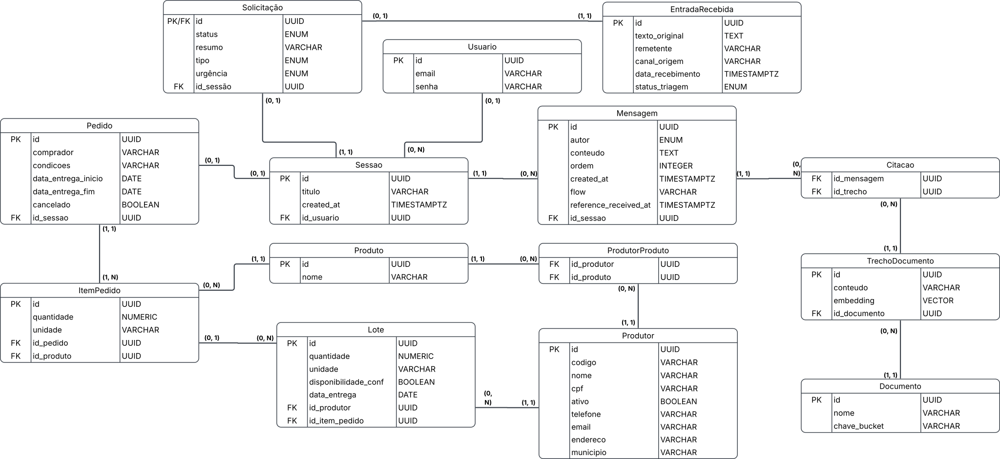

# Banco de dados

O PostgreSQL no Cloud SQL da Google Cloud armazena os usuários, as conversas, os pedidos, os itens, os produtos, os produtores, os Lotes e os dados da consulta documental. A extensão pgvector permite a busca vetorial dos trechos usados no RAG.

Os arquivos originais ficam no Cloud Storage e são representados por `Documento`, que guarda a chave para acessá-los no bucket. Os arquivos de dados fornecidos servem à carga inicial das entidades do sistema. Cada linha aproveitada de `lotes.csv` cria uma instância de `Lote` com os dados úteis às operações e consultas. O vínculo com o arquivo pertence a `Documento`.

## Modelo lógico

Cada solicitação está vinculada a uma sessão de conversa. Uma sessão pode ter até uma solicitação. A opção **Nova conversa** cria uma sessão independente.

Para uma nova demanda recebida por um canal integrado, a aplicação registra a entrada antes da triagem. Após a análise do assistente, os serviços da aplicação criam a solicitação e a sessão na mesma transação. A solicitação fornece os dados do cartão, e a sessão guarda a mensagem original e a análise inicial.

Uma sessão pode ter várias mensagens e até um pedido. O pedido fica disponível no chat da sessão em que foi confirmado. Pedidos cadastrados diretamente podem ficar sem sessão. Cada envio aparece como uma mensagem no histórico do chat.

Um pedido confirmado contém um ou mais itens. Cada `ItemPedido` pertence a um pedido e identifica um produto do catálogo. Um produto pode aparecer em zero ou vários itens.

Cada item pode ser atendido por zero ou vários Lotes. Cada `Lote` pertence a um item e identifica o produtor responsável por uma quantidade do atendimento. Um produtor pode ter zero ou vários Lotes. Alocar significa cadastrar um Lote para atender um item.

`ProdutorProduto` relaciona os produtores aos produtos que fornecem. Cada associação identifica exatamente um produtor e um produto. Um produtor pode fornecer vários produtos, e um produto pode ser fornecido por vários produtores. Ambos podem existir antes de receber associações. Esse relacionamento permite sugerir fornecedores mesmo quando ainda não possuem Lotes cadastrados.

Cada trecho pertence a um documento. Uma resposta pode citar vários trechos, e um trecho pode aparecer em várias respostas. A aplicação usa o documento de cada trecho para abrir o original no bucket. A exclusão é bloqueada quando alguma resposta cita o documento.

## Dicionário de dados

| Entidade | Campos | Restrições |
| --- | --- | --- |
| `Usuario` | `id` (UUID), `email` (VARCHAR), `senha` (VARCHAR) | `id` é a chave primária. O e-mail é único e `senha` guarda o hash. |
| `Sessao` | `id` (UUID), `titulo` (VARCHAR) | `id` é a chave primária. |
| `Solicitacao` | `id` (`UUID`), `status` (`ENUM`), `resumo` (`VARCHAR`), `tipo` (`ENUM`), `urgencia` (`ENUM`), `id_sessao` (`UUID`) | `id` é a chave primária. `id_sessao` é uma FK obrigatória e única para `Sessao`. `status` começa em `recebida` e segue o RF15. `tipo` e `urgencia` seguem o RF04. |
| `Mensagem` | `id` (UUID), `id_sessao` (UUID), `autor` (ENUM), `conteudo` (VARCHAR), `ordem` (INTEGER) | `id` é a chave primária. `id_sessao` é uma FK obrigatória para `Sessao`. `ordem` é única dentro da sessão. |
| `Pedido` | `id` (UUID), `id_sessao` (UUID), `comprador` (VARCHAR), `condicoes` (VARCHAR), `data_entrega_inicio` (DATE), `data_entrega_fim` (DATE), `cancelado` (BOOLEAN) | `id` é a chave primária. `id_sessao` é uma FK opcional e única para `Sessao`. Comprador, data inicial e cancelamento são obrigatórios. Condições e data final podem ficar vazias. Quando preenchida, a data final deve ser igual ou posterior à inicial. |
| `ItemPedido` | `id` (UUID), `quantidade` (NUMERIC), `unidade` (VARCHAR), `id_pedido` (UUID), `id_produto` (UUID) | `id` é a chave primária. `id_pedido` e `id_produto` são FKs obrigatórias para `Pedido` e `Produto`. Quantidade e unidade são obrigatórias no cadastro confirmado. A quantidade deve ser positiva quando preenchida. A carga pode manter quantidade ou unidade pendente de esclarecimento conforme as regras abaixo. |
| `Produto` | `id` (UUID), `nome` (VARCHAR) | `id` é a chave primária. O nome padronizado é obrigatório e único. O catálogo é preenchido pela carga inicial e disponibilizado para consulta e seleção. |
| `Produtor` | `id` (UUID), `codigo` (VARCHAR), `nome` (VARCHAR), `cpf` (VARCHAR), `ativo` (BOOLEAN), `telefone` (VARCHAR), `email` (VARCHAR), `endereco` (VARCHAR), `municipio` (VARCHAR) | `id` é a chave primária. Código, nome, CPF e situação ativo/inativo são obrigatórios. Código e CPF são únicos. Telefone, e-mail, endereço e município podem ficar vazios. |
| `ProdutorProduto` | `id_produtor` (UUID), `id_produto` (UUID) | Os campos são FKs obrigatórias para `Produtor` e `Produto` e formam a chave primária composta. Cada par de produtor e produto aparece uma única vez. |
| `Lote` | `id` (UUID), `quantidade` (NUMERIC), `unidade` (VARCHAR), `disponibilidade_conf` (BOOLEAN), `data_entrega_efetiva` (DATE), `id_produtor` (UUID), `id_item_pedido` (UUID) | `id` é a chave primária. `id_produtor` e `id_item_pedido` são FKs obrigatórias para `Produtor` e `ItemPedido`. A quantidade é obrigatória e positiva. A unidade é obrigatória no cadastro confirmado e pode ficar vazia na carga se estiver indefinida. `disponibilidade_conf` deve ser verdadeira para cadastrar ou editar um fornecimento previsto e pode ficar vazia quando a carga não informar essa confirmação. A data efetiva pode ficar vazia enquanto não houver entrega registrada. |
| `Documento` | `id` (UUID), `nome` (VARCHAR), `chave_bucket` (VARCHAR) | `id` é a chave primária. Nome e chave são obrigatórios. `chave_bucket` é única e identifica o arquivo original no bucket. |
| `TrechoDocumento` | `id` (UUID), `id_documento` (UUID), `conteudo` (VARCHAR), `embedding` (VECTOR) | `id` é a chave primária. `id_documento` é uma FK obrigatória para `Documento`. A dimensão do vetor depende do modelo de embeddings. |
| `Citacao` | `id_mensagem` (UUID), `id_trecho` (UUID) | Os campos são FKs obrigatórias para `Mensagem` e `TrechoDocumento` e formam a chave primária composta. |

## Regras dos pedidos e Lotes

Os produtos solicitados são registrados em `ItemPedido`. O campo `Pedido.condicoes` guarda as condições de atendimento revisadas pelo funcionário. Para entrega em data única, o pedido usa `data_entrega_inicio`. Para um intervalo, usa também `data_entrega_fim`.

O Lote usa o prazo previsto do pedido ao qual seu item pertence. `data_entrega_efetiva` registra a data em que o fornecimento ocorreu, quando conhecida. O resumo por produtor usa o prazo do pedido para fornecimentos previstos e a data efetiva para os realizados.

O saldo do item corresponde à quantidade solicitada menos a soma dos Lotes vinculados, incluindo as quantidades já entregues. O cálculo usa a unidade do item e converte quantidades apenas quando houver equivalência conhecida. Quantidades com unidade indefinida ficam fora dos totais até esclarecimento. Se a quantidade solicitada ou as unidades necessárias ao cálculo estiverem pendentes, o saldo deve ser apresentado como indeterminado.

O funcionário confirma a disponibilidade do produtor para a quantidade, a unidade e o prazo apresentados. Alterações nesses dados ou no produtor exigem que a confirmação corresponda ao fornecimento revisado. Os serviços da aplicação validam os dados atuais no momento da gravação, tanto no cadastro direto quanto na confirmação pelo chat. A gravação deve preservar o limite solicitado mesmo quando outras operações alterarem o saldo ao mesmo tempo.

O cancelamento mantém o pedido disponível para consulta, remove os Lotes de atendimento ainda previsto e preserva os que registram fornecimentos realizados. Os itens necessários a esses Lotes também permanecem disponíveis. A operação deve preservar essa regra mesmo se ocorrer em paralelo ao cadastro de um Lote.

## Carga inicial

O processo de carga associa os produtores e produtos aos registros correspondentes do sistema e cria as associações de `ProdutorProduto`. O catálogo usa nomes padronizados, e a interpretação das mensagens permite ao assistente pedir esclarecimento quando faltar informação para selecionar um produto.

Para os pedidos referenciados em `lotes.csv` e ausentes de `pedidos.json`, a carga agrupa os Lotes pelo pedido indicado no arquivo. Cada grupo gera um pedido com o comprador informado e os itens necessários para vincular seus Lotes. Essa convenção permite manter obrigatórios os relacionamentos de Lote com ItemPedido e de ItemPedido com Pedido.

Como simplificação do MVP, a quantidade inicial de cada item é a soma das quantidades dos Lotes correspondentes quando suas unidades estiverem esclarecidas e forem compatíveis. O prazo inicial do pedido reconstruído é a data de entrega registrada no grupo. Essas quantidades solicitadas e esses prazos são aproximações adotadas para a carga. Os itens com quantidades e unidades definidas começam integralmente atendidos pelos Lotes existentes, com saldo zero.

Os Lotes da base recebem a data efetiva de entrega informada. A carga mantém `disponibilidade_conf` vazia quando a fonte não registrar a confirmação de disponibilidade. Informações conhecidas no registro ou nas observações permitem identificar a unidade, como as 300 unidades de alface e os 150 maços de coentro. Na descrição ambígua "40 maços (kg)", a unidade permanece vazia e a pendência deve ser apresentada ao funcionário. A quantidade solicitada do item reconstruído permanece pendente até ser possível totalizar seus Lotes com segurança.

O cadastro confirmado de um item exige produto, quantidade e unidade definidos. Para cadastrar um novo Lote, o pedido deve estar ativo, o produtor deve estar ativo, a disponibilidade deve estar confirmada e os dados necessários à validação do saldo devem estar esclarecidos. As mensagens originais e os esclarecimentos permanecem na conversa, e o funcionário confirma a versão revisada do rascunho.

A repetição da carga deve reaproveitar os registros já criados e evitar duplicações. Esse controle pertence ao processo de importação e deve preservar os dados já esclarecidos e as exclusões permitidas pela aplicação.
